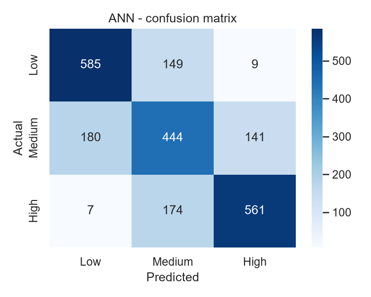
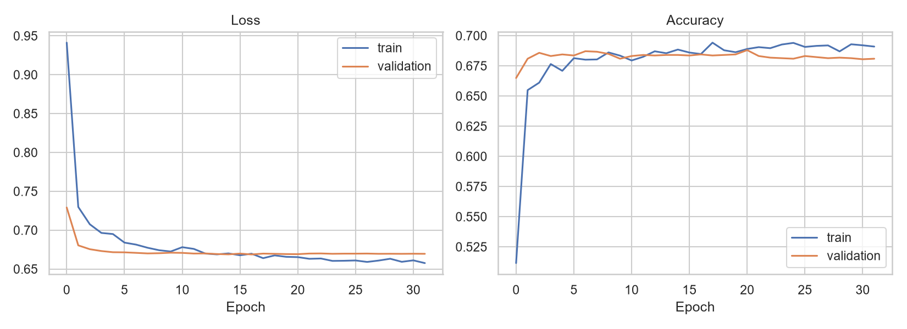

# Evaluation Report - Student Performance ANN

Dataset: 15000 students, 10 input features, target `performance_category` with classes Low, Medium, High.  
Missing values: 0, duplicate rows: 0.  
Class distribution: {'Medium': 5100, 'Low': 4950, 'High': 4950}.

Split: 70% train / 15% validation / 15% test (stratified, seed 42). StandardScaler fitted on the training split only.

## Model comparison (test set)

| Model | Accuracy | Precision (macro) | Recall (macro) | F1 (macro) |
|---|---|---|---|---|
| Logistic Regression (baseline) | 0.7067 | 0.7076 | 0.7080 | 0.7075 |
| ANN (Keras) | 0.7067 | 0.7086 | 0.7079 | 0.7080 |

## ANN per-class results

| Class | Precision | Recall | F1 | Support |
|---|---|---|---|---|
| Low | 0.7578 | 0.7873 | 0.7723 | 743 |
| Medium | 0.5789 | 0.5804 | 0.5796 | 765 |
| High | 0.7890 | 0.7561 | 0.7722 | 742 |

## Confusion matrix (ANN, rows = actual, columns = predicted)

| | Low | Medium | High |
|---|---|---|---|
| Low | 585 | 149 | 9 |
| Medium | 180 | 444 | 141 |
| High | 7 | 174 | 561 |

## Architecture

Input(10) -> Dense(32, ReLU) -> Dropout(0.2) -> Dense(16, ReLU) -> Dense(3, Softmax). Total parameters: 931. Adam (lr 1e-3), sparse categorical cross-entropy, batch size 64, early stopping on validation loss (32 epochs run).

## Observations

- The ANN differs from the Logistic Regression baseline by +0.0000 accuracy. A small difference suggests the classes are mostly separable by roughly linear relationships in these features, so extra network capacity adds little.
- The weakest class by F1 is **Medium**; check the confusion matrix to see which neighbouring class it is confused with (Medium is usually confused with Low/High because it lies between them).
- Study hours per week is the feature whose class means differ most (see correlation heatmap and notebook).
- Train and validation curves staying close indicates the dropout and early stopping controlled overfitting.